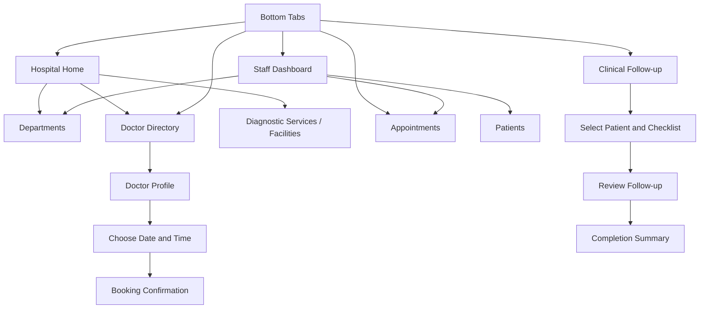

# MediFlow — Hospital Management & Patient Care App

A React Native / Expo demo project that combines four assignment modules in one mobile application:

1. Hospital staff dashboard
2. Doctor directory and appointment booking
3. Guided clinical follow-up workflow
4. Card-based hospital discovery home screen

> **Important:** This project uses mock data and remote demonstration images. It is not connected to a hospital system and must not be used to store real patient information or make real clinical decisions.

## Features

### 1. Hospital staff dashboard
- Patient, appointment, available-doctor and pending-task stat cards.
- Quick actions for Patients, Doctors, Appointments and Departments.
- Recent appointments rendered with `FlatList`.
- Patient search and appointment status filters.

### 2. Doctor directory and booking
- Doctor cards with profile images, specialty, experience, rating and availability.
- Search by doctor name or specialty.
- Filter by specialty.
- Doctor profile screen and booking navigation parameters.
- Select a date, available time slot and visit reason.
- Confirmation screen with booking reference and appointment details.
- Remote image loading indicator and fallback when an image fails.

### 3. Innovative clinical workflow
- Three-step patient follow-up checklist.
- Patient lookup and patient selection.
- Progress bar, completion states and clear next action.
- Review form for visit summary, next-step plan and priority.
- Required-field validation and completion summary.
- Designed to keep patient context visible and reduce screen switching.

### 4. Hospital discovery home
- Search entry point.
- Health-checkup promotional banner.
- Horizontally scrolling `FlatList` sections for departments, doctors, diagnostic services and facilities.
- “View all” actions and clickable cards.
- Bottom-tab navigation.

## Tech stack
- React Native
- Expo SDK 52
- React Navigation native stack and bottom tabs
- `FlatList`, React Hooks and local component state
- `@expo/vector-icons`
- Mock JavaScript data
- Remote images served by Unsplash

## Requirements
- Node.js LTS
- npm
- Expo Go on a compatible phone, or Android Studio / iOS Simulator
- Internet access for package installation and remote images

## Install and run

1. Extract the project ZIP and open a terminal in the `MediFlow` folder.
2. Install dependencies:

   ```bash
   npm install
   ```

3. Start Expo:

   ```bash
   npx expo start
   ```

4. To open the app:
   - Scan the QR code using Expo Go on a compatible device.
   - Press `a` to launch an Android emulator.
   - Press `i` to launch an iOS simulator on macOS.
   - Press `w` to open the web preview (native image/layout behavior may differ).

If the Expo cache causes problems, run:

```bash
npx expo start --clear
```

## Project structure

```text
MediFlow/
├── App.js
├── app.json
├── package.json
├── README.md
├── assets/
│   └── screenshots/
└── src/
    ├── components/
    │   ├── Cards.js
    │   └── UI.js
    ├── data/
    │   └── mockData.js
    ├── navigation/
    │   └── AppNavigator.js
    └── screens/
        ├── CoreScreens.js
        ├── DoctorScreens.js
        └── WorkflowScreens.js
```

## Navigation flow



## Clinical workflow design rationale

**Problem:** A basic implementation may force staff to search for a patient, open multiple pages to understand the context, remember the required steps, and then navigate elsewhere to record a plan. That creates avoidable taps and makes it easier to miss a step.

**Solution:** The “Quick follow-up” workflow puts patient lookup, a three-item checklist, progress feedback and the next action in a guided sequence. A review screen captures a short visit summary, next-step plan and priority. The completion screen displays a concise summary.

**Why it is better:**
- Patient identity stays visible during review.
- Checklist completion is explicit, and the next step stays disabled until all three items are marked.
- A progress indicator communicates where the user is.
- Required summary and plan fields are validated before completion.
- Clear back navigation supports correction without losing the workflow's structure.

The workflow is a UI prototype only; it does not provide clinical recommendations, save to a medical record or replace a clinician's judgment.

## Manual test checklist

- [ ] Home tabs switch correctly.
- [ ] Search doctors by name and specialty.
- [ ] Specialty filters update the directory.
- [ ] Open a doctor profile from a card.
- [ ] Try booking without a time slot; a validation alert appears.
- [ ] Choose date, time and reason; confirmation shows the selected details.
- [ ] Dashboard quick actions open the appropriate modules.
- [ ] Search patients and appointments.
- [ ] Appointment status filters update the list.
- [ ] Try to continue the clinical workflow before all steps are checked; continue is disabled.
- [ ] Leave the clinical summary or plan empty; validation appears.
- [ ] Complete the workflow and review its completion summary.
- [ ] Test back navigation on profile and form screens.
- [ ] Disable network access or use a bad image URL to verify the remote-image fallback.

## Screenshots

Save screenshots captured from a running app in `assets/screenshots/`. Suggested filenames:

- `01-home.png`
- `02-staff-dashboard.png`
- `03-patients.png`
- `04-doctor-directory.png`
- `05-doctor-profile.png`
- `06-booking.png`
- `07-booking-confirmation.png`
- `08-appointments.png`
- `09-departments.png`
- `10-facilities.png`
- `11-clinical-workflow.png`
- `12-workflow-review.png`
- `13-workflow-complete.png`

Screenshots are intentionally not fabricated; capture them on the target device/emulator after launching the app so they represent the actual runtime UI.

## Notes / known demo boundaries
- Bookings and workflow records are held in local screen state and are not persisted to a backend.
- A booking confirmation does not create a real appointment.
- The displayed dashboard counts are illustrative mock values.
- Remote image availability depends on network access and the image host.
- For production use, add authentication, authorization, a secure backend, audit logs, consent/privacy handling, and appropriate clinical-data safeguards.
